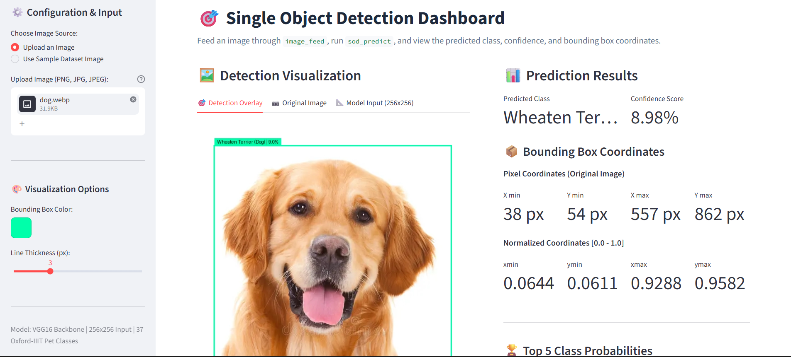

# 🎯 Single Object Detection (SOD) Pipeline & Web UI

An end-to-end Deep Learning system for **Single Object Detection (SOD)** built with **TensorFlow / Keras**, **VGG16 Transfer Learning**, and **Streamlit**. The model performs joint multi-task learning: classifying Oxford-IIIT Pet images across 37 dog and cat breeds while simultaneously regressing the exact object bounding box coordinates.

---

## 🖥️ Web UI Preview



---

## 🌟 Key Features

- **Multi-Task Learning Architecture**: Single unified neural network with dual heads for simultaneous classification (37 classes) and bounding box regression (`[xmin, ymin, xmax, ymax]`).
- **Transfer Learning**: Utilizes pre-trained ImageNet weights on a frozen VGG16 backbone for robust visual feature extraction.
- **Automated Data Processing Pipeline**: Parses Pascal VOC XML annotations, normalizes coordinates to $[0, 1]$, resizes images to $256 \times 256$, and exports serialized NumPy datasets.
- **In-Memory Inference Caching**: Fast predictions using `compile=False` model loading and cached weights.
- **Interactive Streamlit Web Dashboard**:
  - Image drag-and-drop file upload (`PNG`, `JPG`, `JPEG`, `WEBP`) or instant dataset sample selection.
  - Visual bounding box overlay with customizable outline color and stroke thickness.
  - Formatted breed display, confidence percentage metric, and dual-coordinate cards (pixel & normalized).
  - Top-5 prediction probability breakdown and raw prediction tensor inspector.

---

## 📁 Repository Structure

```text
object-detection/
├── asset/
│   └── predict.png             # UI prediction screenshot
├── data/
│   ├── voc-animal/             # Raw dataset (Pascal VOC .jpg images & .xml annotations)
│   └── process-data/           # Preprocessed numpy arrays (.npy)
├── src/
│   ├── data_processecing/      # Data ingestion and preprocessing pipelines
│   │   ├── __init__.py
│   │   ├── data_config.py      # Class mappings (37 breeds), image size (256x256), paths
│   │   ├── process_rawdata.py  # XML parsing & dataset serialization (dataOrganize)
│   │   └── img_feed_pipeline.py# Inference image preprocessor (image_feed)
│   ├── models/                 # Model architectures and training routines
│   │   ├── __init__.py
│   │   └── single_object_detection/
│   │       ├── __init__.py
│   │       ├── README.md       # Detailed Architecture & Mathematical Formulation
│   │       ├── sod_model.py    # VGG16 dual-head model construction & compilation
│   │       ├── sod_training.py # Model training and checkpoint saving
│   │       └── sod_predict.py  # Fast cached inference function
│   └── web_ui/                 # Streamlit web user interface
│       ├── __init__.py
│       └── app.py              # Web dashboard application
├── train_models/               # Directory storing trained model checkpoints (.keras)
├── main.py                     # Entry point for preprocessing raw VOC data
├── train_model.py              # Entry point for training the SOD model
├── ui.py                       # Quick entry point to run the Streamlit Web UI
└── README.md                   # Project documentation
```

---

## 🏗️ Architecture Summary

For in-depth mathematical formulations and layer diagrams, refer to [single_object_detection/README.md](src/models/single_object_detection/README.md).

- **Input Dimension**: `(256, 256, 3)`
- **Backbone**: `VGG16` (ImageNet pre-trained, frozen) + `GlobalAveragePooling2D`
- **Classification Head**: `Dense(256)` + `BatchNorm` + `Dropout(0.4)` $\to$ `Dense(128)` + `Dropout(0.3)` $\to$ `Dense(37, softmax)`
- **Bounding Box Head**: `Dense(256)` + `LeakyReLU(0.1)` $\to$ `Dense(128)` + `LeakyReLU(0.1)` $\to$ `Dense(4, sigmoid)`
- **Loss Formulation**:
  - Classification: `sparse_categorical_crossentropy` (Weight: `1.0`)
  - Bounding Box: `Huber()` loss (Weight: `50.0`)

---

## 🐾 Supported Classes (37 Breeds)

The dataset encompasses 37 cat and dog breeds from the Oxford-IIIT Pet Dataset, including:
- **Cats**: Abyssinian, Bengal, Birman, Bombay, British Shorthair, Egyptian Mau, Maine Coon, Persian, Ragdoll, Russian Blue, Siamese, Sphynx.
- **Dogs**: American Bulldog, American Pit Bull Terrier, Basset Hound, Beagle, Boxer, Chihuahua, English Cocker Spaniel, English Setter, German Shorthaired, Great Pyrenees, Havanese, Japanese Chin, Keeshond, Leonberger, Miniature Pinscher, Newfoundland, Pomeranian, Pug, Saint Bernard, Samoyed, Scottish Terrier, Shiba Inu, Staffordshire Bull Terrier, Wheaten Terrier, Yorkshire Terrier.

---

## 🚀 Running Steps

Follow these step-by-step instructions to set up, preprocess, train, and run the application.

### Step 1: Environment Setup & Dependencies

Ensure you have Python 3.9+ installed. Install the required dependencies:

```bash
pip install tensorflow streamlit opencv-python pillow scikit-learn numpy
```

*(If using Anaconda/Miniconda, activate your target environment first:)*
```bash
conda activate objectDetection
```

---

### Step 2: Data Preprocessing

Convert the raw Pascal VOC images and XML annotations in `data/voc-animal` into normalized NumPy arrays for training:

```bash
python main.py
```

This generates the following serialized artifacts in `data/process-data/`:
- `processImages.npy`: Normalized image arrays (`(N, 256, 256, 3)`)
- `processLabels.npy`: Categorical label integer IDs (`(N,)`)
- `processBBoxes.npy`: Normalized bounding box coordinates `[xmin, ymin, xmax, ymax]` (`(N, 4)`)

---

### Step 3: Train the Model

Train the dual-head Single Object Detection model using the preprocessed data:

```bash
python train_model.py
```

The script splits data into training (75%) and test (25%) partitions, trains the model, and automatically saves the trained weights to:
```text
train_models/SOD_model_v0.1.keras
```

---

### Step 4: Run the Interactive Web UI

Launch the Streamlit web dashboard:

```bash
streamlit run ui.py
```

*Alternatively, run directly from the module:*
```bash
streamlit run src/web_ui/app.py
```

Once launched, open the local URL (typically `http://localhost:8501`) in your browser to:
1. Upload your own pet photo or choose from sample dataset images.
2. View real-time predictions with bounding box overlays, confidence scores, and coordinate metrics.

---
## 🖼️ UI Prediction Preview

Screenshot of the single object detection model during inference, showing the detected animal breed, confidence percentage, and computed bounding box:


### Step 5: Programmatic Inference (Python API)

You can also run inference directly in Python code:

```python
from PIL import Image
from src.data_processecing.img_feed_pipeline import image_feed
from src.models.single_object_detection.sod_predict import sod_predict
from src.data_processecing.data_config import CLASS_MAP

# 1. Load and preprocess image
img = Image.open("data/voc-animal/Abyssinian_1.jpg")
processed_array = image_feed(img)  # Shape: (1, 256, 256, 3)

# 2. Predict
class_preds, bbox_preds = sod_predict(processed_array)

# 3. Decode outputs
id_to_class = {v: k for k, v in CLASS_MAP.items()}
pred_id = class_preds[0].argmax()
class_name = id_to_class[pred_id]
confidence = class_preds[0][pred_id]
bbox = bbox_preds[0]  # [xmin, ymin, xmax, ymax] normalized to [0, 1]

print(f"Detected: {class_name} ({confidence:.2%})")
print(f"Bounding Box: {bbox}")
```
