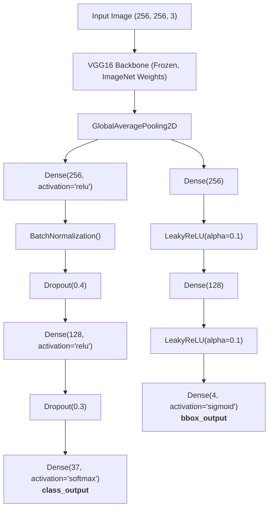

# Single Object Detection (SOD) Architecture

This directory contains the model architecture, training routine, and inference pipeline for **Single Object Detection (SOD)**. The model uses transfer learning with a pre-trained **VGG16** backbone and a dual-head multi-task architecture to simultaneously predict:
1. **Object Classification**: Predicts one of 37 cat and dog breed classes.
2. **Bounding Box Regression**: Predicts normalized coordinates `[xmin, ymin, xmax, ymax]` for the object.

---

## 🏛️ Architecture Overview

The network processes RGB images of resolution `(256, 256, 3)` and splits after feature extraction into two specialized dense branches.

---

## 🔬 Detailed Layer Specification

### 1. Backbone Feature Extractor
- **Base Model**: `VGG16(weights='imagenet', include_top=False, input_shape=(256, 256, 3))`
- **Freezing**: `base.trainable = False` (pre-trained weights kept frozen to preserve low-level and mid-level visual features).
- **Feature Aggregation**: `GlobalAveragePooling2D()` compresses spatial feature maps into a 1D feature vector while mitigating overfitting.

### 2. Classification Head
Designed with Batch Normalization and Dropout regularization to prevent overfitting on 37 fine-grained animal classes:
- `Dense(256, activation='relu')`
- `BatchNormalization()`
- `Dropout(0.4)`
- `Dense(128, activation='relu')`
- `Dropout(0.3)`
- `Dense(37, activation='softmax', name='class_output')`

### 3. Bounding Box Regression Head
Designed for continuous spatial regression without strong compression or non-linear saturation before final output:
- `Dense(256)`
- `LeakyReLU(negative_slope=0.1)` (maintains gradient flow for negative values)
- `Dense(128)`
- `LeakyReLU(negative_slope=0.1)`
- `Dense(4, activation='sigmoid', name='bbox_output')`
  - Output coordinates: `[xmin, ymin, xmax, ymax]`
  - `sigmoid` activation strictly constrains coordinate outputs within the normalized range `[0.0, 1.0]`.

---

## ⚖️ Multi-Task Loss Formulation & Optimization

The network optimizes two separate losses concurrently:

$$\mathcal{L}_{\text{total}} = w_{\text{class}} \cdot \mathcal{L}_{\text{class}} + w_{\text{bbox}} \cdot \mathcal{L}_{\text{bbox}}$$

| Output Head | Loss Function | Loss Weight ($w$) | Metric | Purpose |
| :--- | :--- | :---: | :---: | :--- |
| **`class_output`** | `sparse_categorical_crossentropy` | **`1.0`** | `accuracy` | Multiclass categorical probability distribution |
| **`bbox_output`** | `Huber()` | **`50.0`** | `mae` | Robust regression, combines MSE for small errors and L1 for outliers |

> **Why $w_{\text{bbox}} = 50.0$?**  
> Since bounding box coordinates are normalized in $[0, 1]$, Huber loss values are typically very small ($\approx 0.001 - 0.02$) compared to cross-entropy loss ($\approx 0.5 - 3.5$). The $50\times$ weighting ensures that coordinate regression gradients adequately influence backpropagation alongside classification gradients.

- **Optimizer**: `Adam(learning_rate=1e-4)` (low learning rate suitable for transfer learning).

---

## 📦 Module Files

| File | Description |
| :--- | :--- |
| [sod_model.py] | Defines `sod_modelv01()` architecture, loss functions, and compilation. |
| [sod_training.py] | Loads preprocessed `.npy` arrays, performs train/test splits, fits model, and saves checkpoints to `train_models/`. |
| [sod_predict.py]| High-performance inference function `sod_predict(image)` with memory model caching and `compile=False`. |
| [\_\_init\_\_.py] | Exposes `sod_modelv01`, `train_model`, and `sod_predict`. |
 
---

